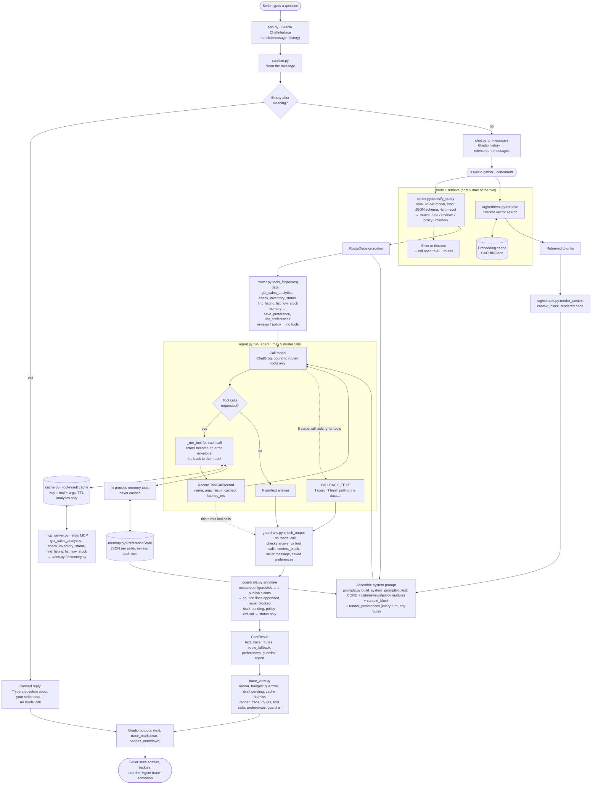

# Request workflow

How one chat turn moves through SellerPulse and back to the seller. Source of truth is the code:
`app.py:handle` → `chat.py:respond` → `agent.py:run_agent`. Rendered by GitHub; any Mermaid viewer works.

## Notes

- **Concurrency:** the classifier and retrieval run together; retrieval is unconditional, so a routing miss never loses context.
- **Fail-open:** a classifier error or 4s timeout routes to all routes (`route_fallback=True`), so nothing is silently dropped.
- **Guardrails annotate, not block:** the seller always gets the answer, with caution lines where a figure or id isn't backed by this turn's evidence.
- **Caching** (`CACHING=on`, app only): query embeddings in retrieval and analytics tool results in the tool loop. Memory tools are never cached. Cache hits show as "(cached)" in the trace.
- **Startup, not per turn:** `app.py:build_app` builds the model client, retriever, preference store, MCP tool list and classifier once.
